# Behavioral Design Patterns Guide (Java)

This document provides a comprehensive reference and study guide for the **Behavioral Design Patterns** defined by the Gang of Four (GoF). It covers the intent, problem solved, real-world analogies, when to use (and when to avoid), pros & cons, code links in this repository, and a comparison/decision matrix.

---

## Table of Contents
1. [Overview & Roadmap](#overview--roadmap)
2. [Strategy Pattern](#1-strategy-pattern)
3. [Observer Pattern](#2-observer-pattern)
4. [Command Pattern](#3-command-pattern)
5. [Chain of Responsibility Pattern](#4-chain-of-responsibility-pattern)
6. [State Pattern](#5-state-pattern)
7. [Template Method Pattern](#6-template-method-pattern)
8. [Iterator Pattern](#7-iterator-pattern)
9. [Mediator Pattern](#8-mediator-pattern)
10. [Memento Pattern](#9-memento-pattern)
11. [Visitor Pattern](#10-visitor-pattern)
12. [Comparison & Decision Matrix](#comparison--decision-matrix)

---

## Overview & Roadmap

Behavioral patterns focus on **algorithms and the assignment of responsibilities between objects**. They characterize complex control flows that are difficult to follow at run-time, shifting focus away from flow of control to the way objects are connected.

```mermaid
graph TD
    DP[Behavioral Design Patterns]
    DP --> ST[1. Strategy<br/><i>Interchangeable algorithms</i>]
    DP --> OB[2. Observer<br/><i>1-to-many event notification</i>]
    DP --> CM[3. Command<br/><i>Request as object with Undo</i>]
    DP --> CR[4. Chain of Responsibility<br/><i>Sequential request processing</i>]
    DP --> SE[5. State<br/><i>State-driven transitions</i>]
    DP --> TM[6. Template Method<br/><i>Algorithm skeleton with step overrides</i>]
    DP --> IT[7. Iterator<br/><i>Collection traversal abstraction</i>]
    DP --> ME[8. Mediator<br/><i>Decoupled component hub</i>]
    DP --> MM[9. Memento<br/><i>State snapshot & restore</i>]
    DP --> VI[10. Visitor<br/><i>Operations separated from AST/data</i>]
```



---

## 1. Strategy Pattern

### Purpose
Defines a family of algorithms, encapsulates each one in its own class, and makes them interchangeable at runtime without modifying the context using them.

### Real-World Analogy
Navigating to the airport: You can take a taxi, subway, bus, or bicycle. Each is a different transportation strategy with distinct trade-offs (cost, time, route), but all fulfill the `goToAirport()` goal.

### When to Use
- When you need different variants of an algorithm (e.g., payment methods, sorting algorithms, compression formats).
- When you have a massive conditional (`if-else` or `switch`) statement choosing among different behaviors.
- When you want to isolate business logic from implementation details of an algorithm.

### Pros & Cons
| Pros | Cons |
|---|---|
| Swap algorithms at runtime. | Clients must be aware of differences between strategies to pick the right one. |
| Eliminates giant `if-else` / `switch` blocks. | Increases the number of classes. |
| Open/Closed Principle: Add new strategies without touching context. | |

### Code in Repository
- Interface: [`PaymentStrategy.java`](src/behavioral/strategy/strategies/PaymentStrategy.java:7)
- Concrete Strategies: [`CreditCardPayment.java`](src/behavioral/strategy/strategies/CreditCardPayment.java:6), [`PayPalPayment.java`](src/behavioral/strategy/strategies/PayPalPayment.java:6), [`CryptoPayment.java`](src/behavioral/strategy/strategies/CryptoPayment.java:6)
- Context: [`ShoppingCart.java`](src/behavioral/strategy/cart/ShoppingCart.java:13), [`Item.java`](src/behavioral/strategy/cart/Item.java:9)
- Demo: [`StrategyDemo.java`](src/behavioral/strategy/StrategyDemo.java:12)

---

## 2. Observer Pattern

### Purpose
Defines a subscription mechanism to notify multiple objects (observers/listeners) simultaneously about any events that happen to the object they are observing (subject/publisher).

### Real-World Analogy
Subscribing to a YouTube channel or newspaper: Whenever the publisher uploads a video or releases an issue, all subscribers receive a notification automatically without polling every 5 minutes.

### When to Use
- When changes to the state of one object require changing other objects, and you don't know beforehand how many objects need to be changed.
- When some objects must observe others, but only for a limited time or dynamically at runtime.
- For building event-driven architectures, GUI event listeners, and pub/sub message brokers.

### Pros & Cons
| Pros | Cons |
|---|---|
| Open/Closed Principle: Introduce new subscriber classes without modifying publisher code. | Subscribers are notified in random/unspecified order. |
| Establish relationships between objects at runtime. | Can cause memory leaks in languages without auto-cleanup if subscribers forget to unsubscribe ("Lapsed Listener problem"). |

### Code in Repository
- Subject Interface: [`Subject.java`](src/behavioral/observer/subject/Subject.java:9)
- Concrete Subject: [`YouTubeChannel.java`](src/behavioral/observer/subject/YouTubeChannel.java:13)
- Observer Interface: [`Observer.java`](src/behavioral/observer/observers/Observer.java:7)
- Concrete Observers: [`EmailSubscriber.java`](src/behavioral/observer/observers/EmailSubscriber.java:7), [`MobileAppSubscriber.java`](src/behavioral/observer/observers/MobileAppSubscriber.java:6), [`AnalyticsTracker.java`](src/behavioral/observer/observers/AnalyticsTracker.java:7)
- Demo: [`ObserverDemo.java`](src/behavioral/observer/ObserverDemo.java:13)

---

## 3. Command Pattern

### Purpose
Turns a request or operation into a stand-alone object containing all information about the request (receiver, method, arguments). This transformation lets you pass requests as method arguments, delay or queue request execution, and support undo/redo.

### Real-World Analogy
A restaurant order slip: The waiter takes your order, writes it on a paper ticket (the Command), and passes it to the kitchen. The chef (Receiver) cooks it according to the ticket. The slip can be queued, delayed, logged, or cancelled.

### When to Use
- When you want to parametrize UI elements (buttons, menu items) with operations.
- When you need to support multi-level **Undo** and **Redo** operations.
- When you want to queue operations, schedule their execution, or execute them remotely over a network.
- For building Macro commands (combining multiple commands into an atomic sequence).

### Pros & Cons
| Pros | Cons |
|---|---|
| Decouples the class invoking an operation from the class performing it. | The code may become more complicated since you introduce a whole new layer of command classes. |
| Implement Undo/Redo cleanly by capturing receiver state. | |
| Combine simple commands into complex macro commands. | |

### Code in Repository
- Command Interface: [`Command.java`](src/behavioral/command/commands/Command.java:7)
- Receivers: [`Light.java`](src/behavioral/command/receiver/Light.java:7), [`AirConditioner.java`](src/behavioral/command/receiver/AirConditioner.java:6)
- Concrete Commands: [`LightOnCommand.java`](src/behavioral/command/commands/LightOnCommand.java:8), [`LightOffCommand.java`](src/behavioral/command/commands/LightOffCommand.java:8), [`DimLightCommand.java`](src/behavioral/command/commands/DimLightCommand.java:8), [`SetACTempCommand.java`](src/behavioral/command/commands/SetACTempCommand.java:8), [`MacroCommand.java`](src/behavioral/command/commands/MacroCommand.java:10)
- Invoker: [`SmartRemoteController.java`](src/behavioral/command/invoker/SmartRemoteController.java:12) (with Undo/Redo stacks)
- Demo: [`CommandDemo.java`](src/behavioral/command/CommandDemo.java:13)

---

## 4. Chain of Responsibility Pattern

### Purpose
Passes requests along a chain of handlers. Upon receiving a request, each handler decides either to process the request or to pass it to the next handler in the chain.

### Real-World Analogy
Customer support escalation or airport security checkpoint:
1. ID Verification -> 2. Baggage Scan -> 3. Body Scanner -> 4. Customs. If any step fails, you are stopped immediately.

### When to Use
- When more than one object may handle a request, and the handler isn't known *a priori*.
- When you want to issue a request to one of several objects without specifying the receiver explicitly.
- In web middleware pipelines (Rate Limiting -> Authentication -> Authorization -> Validation -> Controller).

### Pros & Cons
| Pros | Cons |
|---|---|
| Control the order of request handling dynamically. | Some requests may end up unhandled if they reach the end of the chain without a matching handler. |
| Single Responsibility Principle: Each handler focuses on one check. | Performance overhead if the chain is exceptionally long. |
| Open/Closed Principle: Add new handlers without modifying existing ones. | |

### Code in Repository
- Request Model: [`HttpRequest.java`](src/behavioral/chain_of_responsibility/middleware/HttpRequest.java:6)
- Base Handler: [`MiddlewareHandler.java`](src/behavioral/chain_of_responsibility/middleware/MiddlewareHandler.java:7)
- Concrete Handlers: [`RateLimitMiddleware.java`](src/behavioral/chain_of_responsibility/middleware/RateLimitMiddleware.java:10), [`AuthenticationMiddleware.java`](src/behavioral/chain_of_responsibility/middleware/AuthenticationMiddleware.java:9), [`RoleAuthorizationMiddleware.java`](src/behavioral/chain_of_responsibility/middleware/RoleAuthorizationMiddleware.java:7), [`PayloadValidationMiddleware.java`](src/behavioral/chain_of_responsibility/middleware/PayloadValidationMiddleware.java:7)
- Server Context: [`WebServer.java`](src/behavioral/chain_of_responsibility/server/WebServer.java:9)
- Demo: [`ChainOfResponsibilityDemo.java`](src/behavioral/chain_of_responsibility/ChainOfResponsibilityDemo.java:12)

---

## 5. State Pattern

### Purpose
Allows an object to alter its behavior when its internal state changes. The object will appear to change its class.

### Real-World Analogy
Smartphone lock screen vs unlocked screen:
- Pressing the screen while locked only shows the clock/notifications.
- Pressing the screen while unlocked launches apps and takes user inputs. The phone is the same physical object, but its response to taps completely changes based on state.

### When to Use
- When you have an object that behaves differently depending on its current state, the number of states is enormous, and state-specific code changes frequently.
- When you have a class polluted with massive conditionals (`switch (status)`) that duplicate logic across every method.
- For modeling workflows, state machines, and finite-state automata (e.g. Order Lifecycle: New -> Paid -> Shipped -> Delivered).

### Pros & Cons
| Pros | Cons |
|---|---|
| Single Responsibility: Organize state-specific code into dedicated classes. | Can be overkill if a state machine has only 2–3 simple states that rarely change. |
| Open/Closed Principle: Introduce new states without altering existing state classes or context. | |
| Eliminates fragile state conditional logic. | |

### Code in Repository
- State Interface: [`OrderState.java`](src/behavioral/state/states/OrderState.java:9)
- Concrete States: [`NewOrderState.java`](src/behavioral/state/states/NewOrderState.java:9), [`PaidOrderState.java`](src/behavioral/state/states/PaidOrderState.java:9), [`ShippedOrderState.java`](src/behavioral/state/states/ShippedOrderState.java:9), [`DeliveredOrderState.java`](src/behavioral/state/states/DeliveredOrderState.java:8), [`CancelledOrderState.java`](src/behavioral/state/states/CancelledOrderState.java:8)
- Context Class: [`Order.java`](src/behavioral/state/order/Order.java:10)
- Demo: [`StateDemo.java`](src/behavioral/state/StateDemo.java:8)

---

## 6. Template Method Pattern

### Purpose
Defines the skeleton of an algorithm in the superclass but lets subclasses override specific steps of the algorithm without changing its overarching structure.

### Real-World Analogy
Building a prefabricated house: The architectural blueprint has fixed steps: Foundation -> Frame -> Walls -> Roof -> Interior. Subclasses customize the materials (wood vs brick walls), but cannot change the order of building foundation before roof.

### When to Use
- When you want to let clients extend only particular steps of an algorithm, but not the whole algorithm or its structure.
- When you have multiple classes containing almost identical algorithms with only minor differences.
- In frameworks where the framework controls the lifecycle and calls user-defined hooks ("Don't call us, we'll call you" - Hollywood Principle).

### Pros & Cons
| Pros | Cons |
|---|---|
| Code reuse: Pull shared invariant algorithm code into a base class. | Subclasses might be constrained by the rigid skeleton provided by the superclass. |
| Subclasses can selectively override only parts they care about. | Maintenance overhead if base template method changes. |

### Code in Repository
- Base Abstract Template: [`DataMiner.java`](src/behavioral/template_method/miners/DataMiner.java:9) (`final mine()` method + hooks)
- Concrete Subclasses: [`CsvDataMiner.java`](src/behavioral/template_method/miners/CsvDataMiner.java:10), [`PdfDataMiner.java`](src/behavioral/template_method/miners/PdfDataMiner.java:10), [`JsonDataMiner.java`](src/behavioral/template_method/miners/JsonDataMiner.java:10)
- Demo: [`TemplateMethodDemo.java`](src/behavioral/template_method/TemplateMethodDemo.java:11)

---

## 7. Iterator Pattern

### Purpose
Provides a way to access elements of an aggregate object sequentially without exposing its underlying representation (array, list, tree, graph, hash map).

### Real-World Analogy
Audio playlist player: You can press "Next" and "Previous" regardless of whether the playlist is stored in memory as an array, a linked list, or fetched over a cloud API.

### When to Use
- When your collection has a complex data structure (tree, graph) under the hood, but you want to hide its complexity from clients.
- To reduce duplication of traversal code across your app.
- When you want your code to be able to traverse different data structures (e.g. Breadth-First vs Depth-First) using a uniform interface.

### Pros & Cons
| Pros | Cons |
|---|---|
| Single Responsibility: Extract traversal algorithms into separate iterator classes. | Applying the pattern can be overkill if your app only works with simple arrays/lists. |
| Open/Closed Principle: Implement new types of collections and iterators without breaking client code. | |
| Parallel/multiple simultaneous traversals over the same collection. | |

### Code in Repository
- Iterator Interface: [`CustomIterator.java`](src/behavioral/iterator/iterator/CustomIterator.java:7)
- Aggregate Interface: [`EmployeeHierarchy.java`](src/behavioral/iterator/collection/EmployeeHierarchy.java:9)
- Element Node: [`Employee.java`](src/behavioral/iterator/collection/Employee.java:11)
- Aggregate with Inner Iterators (BFS, DFS, Filter): [`OrganizationTree.java`](src/behavioral/iterator/collection/OrganizationTree.java:11)
- Demo: [`IteratorDemo.java`](src/behavioral/iterator/IteratorDemo.java:11)

---

## 8. Mediator Pattern

### Purpose
Restricts direct communications between objects and forces them to collaborate only via a mediator object. This reduces chaotic dependencies among communicating classes.

### Real-World Analogy
Air Traffic Control (ATC) Tower at an airport: Airplanes do not talk directly to 30 other planes to negotiate who lands first on Runway 22L. They talk **only to the control tower**, which decides priority, runway clearance, and safety holding patterns.

### When to Use
- When it's hard to change some of the classes because they are tightly coupled to a dozen other classes ($N \times N$ connections).
- When you can't reuse a component in a different program because it's too dependent on other components.
- In GUI dialog windows, chat room servers, and service mesh coordinators.

### Pros & Cons
| Pros | Cons |
|---|---|
| Single Responsibility: Centralizes communications between various components into one place. | Over time, a mediator can evolve into a "God Object" (anti-pattern) if it handles too much. |
| Loose Coupling: Colleagues know nothing about each other. | |
| Simplify maintenance from $N \times N$ to $1 \times N$ connections. | |

### Code in Repository
- Mediator Interface: [`AirTrafficControl.java`](src/behavioral/mediator/mediator/AirTrafficControl.java:9)
- Concrete Mediator: [`AirportControlTower.java`](src/behavioral/mediator/mediator/AirportControlTower.java:13)
- Colleague Base: [`Flight.java`](src/behavioral/mediator/colleague/Flight.java:9)
- Concrete Colleague: [`CommercialFlight.java`](src/behavioral/mediator/colleague/CommercialFlight.java:8)
- Demo: [`MediatorDemo.java`](src/behavioral/mediator/MediatorDemo.java:9)

---

## 9. Memento Pattern

### Purpose
Captures and externalizes an object's internal state so that the object can be restored to this state later, without violating encapsulation or exposing private fields.

### Real-World Analogy
Game Save Checkpoints / Undo in Text Editors: Before fighting a boss or making a risky move, you create a save slot (Memento). If you fail, you load the save game to restore health, inventory, and location exactly as they were.

### When to Use
- When you want to produce snapshots of the object's state to be able to restore a previous state of the object.
- When direct access to the object's fields/getters/setters would violate its encapsulation.
- For implementing multi-level transaction rollbacks, undo/redo history managers, and recovery logs.

### Key Roles
1. **Originator** ([`TextEditor`](src/behavioral/memento/editor/TextEditor.java:7)): The object whose state is saved. Creates and consumes mementos.
2. **Memento** ([`EditorState`](src/behavioral/memento/editor/EditorState.java:10)): Immutable snapshot value object.
3. **Caretaker** ([`EditorHistory`](src/behavioral/memento/caretaker/EditorHistory.java:13)): Stores and manages history stacks without inspecting memento internals.

### Pros & Cons
| Pros | Cons |
|---|---|
| Produces snapshots of an object's state without violating its encapsulation. | Consumes large amounts of RAM if clients create mementos frequently for heavy objects. |
| Simplifies originator code by letting caretaker maintain history. | Caretaker must track originator lifecycle to destroy obsolete mementos. |

### Code in Repository
- Memento (Immutable Snapshot): [`EditorState.java`](src/behavioral/memento/editor/EditorState.java:10)
- Originator: [`TextEditor.java`](src/behavioral/memento/editor/TextEditor.java:7)
- Caretaker: [`EditorHistory.java`](src/behavioral/memento/caretaker/EditorHistory.java:13)
- Demo: [`MementoDemo.java`](src/behavioral/memento/MementoDemo.java:10)

---

## 10. Visitor Pattern

### Purpose
Separates an algorithm from the object structure on which it operates, allowing you to add new operations to existing class structures without modifying them (using **Double Dispatch**).

### Real-World Analogy
Insurance agent visiting households: An insurance agent (Visitor) visits various residents (Elements: Person, Building, Vehicle). The agent offers different policies depending on whether the element is a commercial building, a car, or an individual, without modifying how buildings or cars are constructed.

### When to Use
- When you need to perform an operation on all elements of a complex object tree (e.g., an AST / Document AST).
- When you want to clean up business logic of auxiliary operations (e.g. Export to XML, Export to Markdown, Generate Metrics) from the core data classes.
- When the object structure rarely changes, but you frequently add new operations over the structure.

### Pros & Cons
| Pros | Cons |
|---|---|
| Open/Closed Principle: Add new behaviors on complex object structures without modifying element classes. | Adding a *new element class* requires updating the visitor interface and all concrete visitors. |
| Single Responsibility: Group related behaviors into a single visitor class. | Visitors might lack access to private fields of elements if encapsulation is strict. |

### Code in Repository
- Element Interface: [`DocumentElement.java`](src/behavioral/visitor/elements/DocumentElement.java:9)
- Concrete Elements: [`HeadingElement.java`](src/behavioral/visitor/elements/HeadingElement.java:8), [`ParagraphElement.java`](src/behavioral/visitor/elements/ParagraphElement.java:8), [`ImageElement.java`](src/behavioral/visitor/elements/ImageElement.java:8), [`TableElement.java`](src/behavioral/visitor/elements/TableElement.java:11)
- Visitor Interface: [`DocumentVisitor.java`](src/behavioral/visitor/visitors/DocumentVisitor.java:11)
- Concrete Visitors: [`MarkdownExportVisitor.java`](src/behavioral/visitor/visitors/MarkdownExportVisitor.java:13), [`HtmlExportVisitor.java`](src/behavioral/visitor/visitors/HtmlExportVisitor.java:13), [`DocumentStatsVisitor.java`](src/behavioral/visitor/visitors/DocumentStatsVisitor.java:13)
- Document AST: [`Document.java`](src/behavioral/visitor/document/Document.java:11)
- Demo: [`VisitorDemo.java`](src/behavioral/visitor/VisitorDemo.java:17)

---

## Comparison & Decision Matrix

| Pattern | Core Intent | Key Distinction |
|---|---|---|
| **Strategy** | Swapping whole algorithms | Client injects algorithm to context; interchangeable at runtime. |
| **State** | Behavior changes based on internal state | State classes control transitions; context appears to change class. |
| **Command** | Encapsulating requests as objects | Supports queued execution, history tracking, and Undo/Redo. |
| **Chain of Responsibility** | Passing requests along a handler pipeline | Decouples sender from receivers; supports short-circuiting. |
| **Observer** | 1-to-many event notification | Publisher does not know specific subscriber classes; dynamic subscribe/unsubscribe. |
| **Mediator** | Many-to-many communication hub | Replaces chaotic $N \times N$ colleague dependencies with $1 \times N$ hub. |
| **Template Method** | Fixed algorithm skeleton with customizable steps | Uses inheritance and `final` template method with abstract primitives & hooks. |
| **Iterator** | Traversing collections polymorphically | Hides underlying data structure (tree, array, list) behind `hasNext()` / `next()`. |
| **Memento** | State snapshot and restoration | Captures state without violating encapsulation (Originator, Memento, Caretaker). |
| **Visitor** | Adding new operations to existing AST/structure | Uses Double Dispatch (`accept(visitor)` -> `visitElement(this)`) without altering elements. |

---

## Quick Selection Guide

```
What is your primary behavioral problem?
│
├── Need to swap business algorithms at runtime? (e.g. Payment methods)
│   └── YES ──> [ Strategy ]
│
├── Need to notify multiple objects when an event occurs? (e.g. Channel upload)
│   └── YES ──> [ Observer ]
│
├── Need to encapsulate actions to support Undo/Redo or Queuing? (e.g. Remote button)
│   └── YES ──> [ Command ]
│
├── Need a sequential pipeline where handlers process or pass requests? (e.g. Middleware)
│   └── YES ──> [ Chain of Responsibility ]
│
├── Object behavior changes drastically depending on its lifecycle state? (e.g. Order status)
│   └── YES ──> [ State ]
│
├── Fixed algorithm skeleton with customizable sub-steps/hooks? (e.g. Data miners)
│   └── YES ──> [ Template Method ]
│
├── Need to traverse complex trees/graphs without exposing structure? (e.g. BFS/DFS)
│   └── YES ──> [ Iterator ]
│
├── Many objects talk chaotically to each other ($N x N$)? (e.g. Airport ATC Tower)
│   └── YES ──> [ Mediator ]
│
├── Need to save/restore state snapshots for rollbacks without breaking private fields?
│   └── YES ──> [ Memento ]
│
└── Need to add new operations (e.g. HTML/Markdown export) to existing class structures?
    └── YES ──> [ Visitor ]
```
