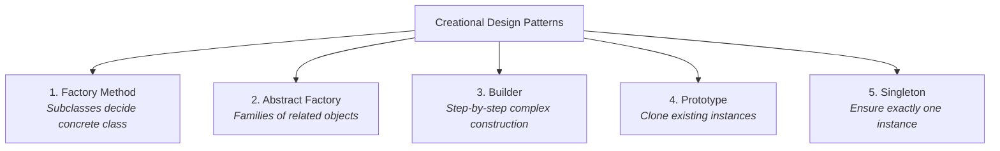

# Creational Design Patterns Guide (Java)

This document provides a comprehensive guide to the **5 Creational Design Patterns** defined by the Gang of Four (GoF), including their purpose, real-world analogies, when to use them, implementation links, and comparison matrices.

---

## Table of Contents
1. [Overview](#overview)
2. [Factory Method Pattern](#1-factory-method-pattern)
3. [Abstract Factory Pattern](#2-abstract-factory-pattern)
4. [Builder Pattern](#3-builder-pattern)
5. [Prototype Pattern](#4-prototype-pattern)
6. [Singleton Pattern](#5-singleton-pattern)
7. [Comparison & Decision Matrix](#comparison--decision-matrix)

---

## Overview

Creational design patterns deal with **object creation mechanisms**. They abstract the instantiation process, making a system independent of how its objects are created, composed, and represented.



---

## 1. Factory Method Pattern

### Purpose
Defines an interface for creating an object, but lets subclasses decide which class to instantiate. Factory Method lets a class defer instantiation to subclasses.

### Real-World Analogy
A postal logistics company has standard operations (`planDelivery()`), but different branches create different vehicles:
- Road branch instantiates `Truck`
- Sea branch instantiates `Ship`
- Air branch instantiates `Plane`

### When to Use
- When you do not know beforehand the exact types and dependencies of the objects your code should work with.
- When you want to provide users of your library/framework with a way to extend its internal components.
- When you want to save system resources by reusing existing objects instead of rebuilding them each time.

### Pros & Cons
| Pros | Cons |
|---|---|
| Avoids tight coupling between creator and concrete products. | Code may become more complicated since you need to introduce new subclasses for each new product. |
| **Single Responsibility Principle**: Product creation code is consolidated in one place. | |
| **Open/Closed Principle**: You can introduce new product variants without breaking existing client code. | |

### Java Code in this Repository
- Product Interface: [`Transport.java`](src/creational/factory_method/transport/Transport.java:7)
- Concrete Products: [`Truck.java`](src/creational/factory_method/transport/Truck.java:6), [`Ship.java`](src/creational/factory_method/transport/Ship.java:6), [`Plane.java`](src/creational/factory_method/transport/Plane.java:6)
- Creator Base Class: [`Logistics.java`](src/creational/factory_method/logistics/Logistics.java:10)
- Concrete Creators: [`RoadLogistics.java`](src/creational/factory_method/logistics/RoadLogistics.java:10), [`SeaLogistics.java`](src/creational/factory_method/logistics/SeaLogistics.java:10), [`AirLogistics.java`](src/creational/factory_method/logistics/AirLogistics.java:10)
- Parametrized Simple Factory: [`TransportFactory.java`](src/creational/factory_method/simple_factory/TransportFactory.java:12)
- Runnable Demo: [`FactoryMethodDemo.java`](src/creational/factory_method/FactoryMethodDemo.java:11)

---

## 2. Abstract Factory Pattern

### Purpose
Provides an interface for creating families of related or dependent objects without specifying their concrete classes.

### Real-World Analogy
A cross-platform UI toolkit:
- On **Windows**, it creates a Windows Button and Windows Checkbox.
- On **macOS**, it creates a Mac Button and Mac Checkbox.
- The client UI code only interacts with abstract `Button` and `Checkbox` interfaces, ensuring products from different operating systems are never accidentally mixed.

### When to Use
- When a system should be independent of how its products are created, composed, and represented.
- When a system needs to be configured with one of multiple families of products (e.g., Light vs. Dark theme, Windows vs. Mac UI, SQL vs. NoSQL driver families).
- When a family of related product objects is designed to be used together, and you need to enforce this constraint.

### Pros & Cons
| Pros | Cons |
|---|---|
| Ensures compatibility of products within a family. | Can become overly complex and difficult to extend if you need to add *new types of products* (requires changing the abstract factory and all its concrete implementations). |
| Avoids tight coupling between concrete products and client code. | |
| Follows Single Responsibility and Open/Closed principles. | |

### Java Code in this Repository
- Abstract Products: [`Button.java`](src/creational/abstract_factory/products/Button.java:6), [`Checkbox.java`](src/creational/abstract_factory/products/Checkbox.java:6)
- Concrete Products: [`WindowsButton.java`](src/creational/abstract_factory/products/WindowsButton.java:6), [`MacButton.java`](src/creational/abstract_factory/products/MacButton.java:6), [`WindowsCheckbox.java`](src/creational/abstract_factory/products/WindowsCheckbox.java:6), [`MacCheckbox.java`](src/creational/abstract_factory/products/MacCheckbox.java:6)
- Abstract Factory: [`GUIFactory.java`](src/creational/abstract_factory/factories/GUIFactory.java:9)
- Concrete Factories: [`WindowsFactory.java`](src/creational/abstract_factory/factories/WindowsFactory.java:12), [`MacFactory.java`](src/creational/abstract_factory/factories/MacFactory.java:12)
- Client Application: [`Application.java`](src/creational/abstract_factory/app/Application.java:11)
- Runnable Demo: [`AbstractFactoryDemo.java`](src/creational/abstract_factory/AbstractFactoryDemo.java:11)

---

## 3. Builder Pattern

### Purpose
Separates the construction of a complex object from its representation, so that the same construction process can create different representations.

### Real-World Analogy
Custom ordering a computer:
- You select mandatory base parts (CPU, RAM, Storage).
- You optionally customize the GPU, liquid cooling, RGB lighting, OS, etc.
- A **Director** can provide standard pre-configured recipes ("Office PC", "Gaming Rig", "Server").

### When to Use
- To eliminate the **Telescoping Constructor anti-pattern** (constructors with 10+ arguments where many are optional/null).
- When you want code to create different representations of some product (e.g., custom HTTP requests, query builders, complex domain entities).
- When constructing objects requires complex step-by-step logic, validation, or immutability.

### Pros & Cons
| Pros | Cons |
|---|---|
| Allows step-by-step object construction and deferred execution. | Overall complexity increases as you must create a dedicated Builder class alongside the product. |
| Reuses the same construction code for different representations. | |
| Enforces **immutability** without exposing mutable setters. | |

### Java Code in this Repository
- Product & Inner Builder: [`Computer.java`](src/creational/builder/model/Computer.java:7)
- Director (Predefined recipes): [`ComputerDirector.java`](src/creational/builder/director/ComputerDirector.java:9)
- Runnable Demo: [`BuilderDemo.java`](src/creational/builder/BuilderDemo.java:10)

---

## 4. Prototype Pattern

### Purpose
Specifies the kinds of objects to create using a prototypical instance, and creates new objects by copying (cloning) this prototype.

### Real-World Analogy
Mitosis / Cell Division or Stencil / Blueprint:
- Instead of rebuilding an object from scratch (which may require heavy DB queries, external API calls, or complicated math), you clone an existing configured instance and tweak only the fields that differ.

### When to Use
- When the cost of creating an object is expensive or complex (e.g., database round-trips, parsing large config files).
- When you want to clone objects without coupling your code to their concrete classes.
- When you want to eliminate repeated subclass initialization logic.

### Pros & Cons
| Pros | Cons |
|---|---|
| Clone objects without coupling to concrete classes. | Cloning complex objects that have circular references or deep object graphs can be tricky. |
| Avoids expensive repeated initialization code. | |
| Alternative to inheritance for pre-set configurations. | |

### Java Code in this Repository
- Prototype Interface: [`Prototype.java`](src/creational/prototype/shapes/Prototype.java:6)
- Abstract Shape with Copy Constructor: [`Shape.java`](src/creational/prototype/shapes/Shape.java:8)
- Concrete Shapes: [`Circle.java`](src/creational/prototype/shapes/Circle.java:8), [`Rectangle.java`](src/creational/prototype/shapes/Rectangle.java:8)
- Prototype Registry / Cache: [`ShapeRegistry.java`](src/creational/prototype/registry/ShapeRegistry.java:12)
- Runnable Demo: [`PrototypeDemo.java`](src/creational/prototype/PrototypeDemo.java:13)

---

## 5. Singleton Pattern

### Purpose
Ensures that a class has only one instance and provides a global access point to it.

### Real-World Analogy
A country's government / central bank or a system's spooler/logging subsystem:
- There is only one active instance coordinating state across all threads/processes.

### When to Use
- When a class in your program should have just a single instance available to all clients (e.g., Database connection pool, Logging service, Application configuration manager, Hardware device controller).
- When you need stricter control over global variables.

### Common Java Implementations
1. **Eager Initialization**: Loaded when class is loaded (thread-safe, not lazy).
2. **Double-Checked Locking**: Thread-safe lazy loading with `volatile` and `synchronized` block.
3. **Bill Pugh Holder Idiom**: Lazy loaded via a static inner holder class (thread-safe, high performance, no synchronization overhead).
4. **Enum Singleton**: Recommended by *Effective Java* (100% immune to reflection and serialization attacks).

### Pros & Cons
| Pros | Cons |
|---|---|
| Guaranteed single instance across the JVM. | Violates the **Single Responsibility Principle** (solves two problems at once: uniqueness + global access). |
| Global point of access. | Can make unit testing difficult (hard to mock without DI frameworks). |
| Lazy initialization saves memory and startup time. | Can mask bad design (tight coupling across modules). |

### Java Code in this Repository
- Eager Singleton: [`EagerSingleton.java`](src/creational/singleton/EagerSingleton.java:9)
- Double-Checked Locking Singleton: [`DoubleCheckedLockingSingleton.java`](src/creational/singleton/DoubleCheckedLockingSingleton.java:13)
- Bill Pugh Singleton: [`BillPughSingleton.java`](src/creational/singleton/BillPughSingleton.java:9)
- Enum Singleton: [`EnumSingleton.java`](src/creational/singleton/EnumSingleton.java:9)
- Runnable Concurrency / Security Demo: [`SingletonDemo.java`](src/creational/singleton/SingletonDemo.java:13)

---

## Comparison & Decision Matrix

| Pattern | Primary Focus | Key Mechanism | Relationship to other patterns |
|---|---|---|---|
| **Factory Method** | Creation of **one** product via inheritance | Method overriding in subclasses | Often evolves into Abstract Factory, Prototype, or Builder. |
| **Abstract Factory** | Creation of **families of related products** | Object composition & interfaces | Factories are often implemented using Factory Methods or Prototype. |
| **Builder** | Step-by-step construction of **complex objects** | Fluent API / Chained methods | Can use Singleton for Director. |
| **Prototype** | Cloning existing instances without class coupling | Copy constructor or `.clone()` | Can be stored in a Registry or combined with Abstract Factory. |
| **Singleton** | Enforcing **exactly one instance** | Private constructor + static accessor | Abstract Factory, Builder, and Prototype instances are frequently Singletons. |

---

## Quick Selection Guide

```
Need to create an object?
│
├── Do you need only ONE instance across the entire application?
│   └── YES ──> [ Singleton ]
│
├── Is creation expensive / need to duplicate configured instances?
│   └── YES ──> [ Prototype ]
│
├── Does the object have many parameters / complex step-by-step assembly?
│   └── YES ──> [ Builder ]
│
├── Do you need to create entire families of related products (e.g. Win/Mac)?
│   └── YES ──> [ Abstract Factory ]
│
└── Do you want subclasses to decide which individual product class to instantiate?
    └── YES ──> [ Factory Method ]
```
