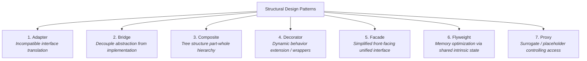

# Structural Design Patterns Guide (Java)

This document provides a comprehensive reference and study guide for the **7 Structural Design Patterns** defined by the Gang of Four (GoF). It covers the intent, problem solved, real-world analogies, when to use (and when to avoid), pros & cons, code links in this repository, and a comparison/decision matrix.

---

## Table of Contents
1. [Overview & Roadmap](#overview--roadmap)
2. [Adapter Pattern](#1-adapter-pattern)
3. [Bridge Pattern](#2-bridge-pattern)
4. [Composite Pattern](#3-composite-pattern)
5. [Decorator Pattern](#4-decorator-pattern)
6. [Facade Pattern](#5-facade-pattern)
7. [Flyweight Pattern](#6-flyweight-pattern)
8. [Proxy Pattern](#7-proxy-pattern)
9. [Comparison & Decision Matrix](#comparison--decision-matrix)
10. [Quick Selection Guide](#quick-selection-guide)

---

## Overview & Roadmap

Structural design patterns explain how to **assemble objects and classes into larger structures while keeping these structures flexible and efficient**. They ease design by identifying a simple way to realize relationships between entities.



---

## 1. Adapter Pattern

### Purpose
Converts the interface of a class into another interface that clients expect. Adapter lets classes work together that couldn't otherwise because of incompatible interfaces.

### Real-World Analogy
A power plug adapter: A US 2-prong plug cannot plug into a European 230V socket directly. The adapter fits both ends, translating the shape without changing the electrical current function.

### When to Use
- When you want to use an existing class, but its interface does not match the one your code requires.
- When integrating third-party libraries or legacy modules whose source code you cannot (or should not) alter.
- When you need to translate data formats across subsystems (e.g., XML to JSON).

### Pros & Cons
| Pros | Cons |
|---|---|
| **Single Responsibility Principle**: Separates interface conversion code from primary business logic. | Overall code complexity increases with added adapter classes. |
| **Open/Closed Principle**: Introduce new adapters without breaking existing client code. | Sometimes simpler to change the service class directly if you own it. |

### Code in Repository
- Target Interface: [`StockAnalyticsService.java`](src/structural/adapter/target/StockAnalyticsService.java:7)
- Adaptee (Legacy XML): [`LegacyXmlStockProvider.java`](src/structural/adapter/adaptee/LegacyXmlStockProvider.java:7)
- Modern Implementation: [`JsonStockAnalytics.java`](src/structural/adapter/target/JsonStockAnalytics.java:6)
- Adapter: [`XmlToJsonStockAdapter.java`](src/structural/adapter/adapter/XmlToJsonStockAdapter.java:11)
- Demo: [`AdapterDemo.java`](src/structural/adapter/AdapterDemo.java:10)

---

## 2. Bridge Pattern

### Purpose
Decouples an abstraction from its implementation so that the two can vary independently.

### Real-World Analogy
Remote controls and electronic devices: A `BasicRemote` or `AdvancedRemote` (Abstraction) controls a `SonyTv` or `PhilipsRadio` (Implementation). You can add a new remote (e.g. `VoiceRemote`) without altering TV code, and you can add a `SamsungTV` without altering remote code.

### When to Use
- When you want to divide a monolithic class that has multiple independent dimensions of variability (e.g., Remote features vs. Device platforms, GUI shapes vs. Rendering engines).
- When you need to switch implementations at runtime.
- To avoid a combinatorial explosion of subclasses ($M \times N$ classes reduced to $M + N$).

### Pros & Cons
| Pros | Cons |
|---|---|
| Decouples high-level control logic from platform-specific code. | Can make code more complicated by introducing extra layers of abstraction. |
| Open/Closed Principle: Extend abstractions and implementations independently. | Requires identifying orthogonal dimensions of variation early. |
| Single Responsibility Principle: Abstraction handles logic; implementation handles platform mechanics. | |

### Code in Repository
- Implementation Interface: [`Device.java`](src/structural/bridge/devices/Device.java:6)
- Concrete Implementations: [`SonyTv.java`](src/structural/bridge/devices/SonyTv.java:6), [`PhilipsRadio.java`](src/structural/bridge/devices/PhilipsRadio.java:6)
- Abstraction Base: [`BasicRemote.java`](src/structural/bridge/remotes/BasicRemote.java:10)
- Refined Abstractions: [`AdvancedRemote.java`](src/structural/bridge/remotes/AdvancedRemote.java:9), [`SmartTouchRemote.java`](src/structural/bridge/remotes/SmartTouchRemote.java:9)
- Demo: [`BridgeDemo.java`](src/structural/bridge/BridgeDemo.java:13)

---

## 3. Composite Pattern

### Purpose
Composes objects into tree structures to represent part-whole hierarchies. Composite lets clients treat individual objects (leaves) and compositions of objects (branches/containers) uniformly.

### Real-World Analogy
A file system: A directory contains files and subdirectories. Both a single file (`FileItem`) and a folder (`FolderItem`) respond to `getSize()` or `printHierarchy()`, with the folder recursively summing and delegating to all its children.

### When to Use
- When you need to implement a tree-like object structure (e.g., UI DOM trees, organizational charts, graphics scene graphs, file systems).
- When you want client code to treat simple and complex elements uniformly without checking `if (item instanceof Folder)`.

### Pros & Cons
| Pros | Cons |
|---|---|
| Simplifies client code through polymorphism across leaves and composites. | Hard to restrict the types of components that can be added to a composite at compile time. |
| Open/Closed Principle: Add new element types easily into the tree. | Heavy recursion can cause stack issues on exceptionally deep trees. |

### Code in Repository
- Component Interface: [`FileSystemItem.java`](src/structural/composite/filesystem/FileSystemItem.java:8)
- Leaf Class: [`FileItem.java`](src/structural/composite/filesystem/FileItem.java:9)
- Composite Class: [`FolderItem.java`](src/structural/composite/filesystem/FolderItem.java:12)
- Demo: [`CompositeDemo.java`](src/structural/composite/CompositeDemo.java:10)

---

## 4. Decorator Pattern

### Purpose
Attaches additional responsibilities to an object dynamically. Decorators provide a flexible alternative to subclassing for extending functionality.

### Real-World Analogy
Coffee ordering: You start with a base coffee (`Espresso` or `DarkRoast`) and wrap it with condiments (`Milk`, `Mocha`, `Caramel`, `WhippedCream`). Each condiment wraps the previous beverage, appending to description and adding to cost.

### When to Use
- When you want to assign extra behaviors to objects at runtime without breaking existing code.
- When extending an object's behavior via inheritance is awkward or impossible (e.g. `final` classes or exponential subclass explosion).
- Examples: Java I/O Streams (`new BufferedReader(new InputStreamReader(new FileInputStream(...)))`), HTTP request interceptors, logging wrappers.

### Pros & Cons
| Pros | Cons |
|---|---|
| Extend object behavior dynamically without creating hundreds of subclasses. | Hard to remove a specific wrapper from deep within the wrapper stack. |
| Combine several behaviors by wrapping an object with multiple decorators. | Initial configuration of deeply nested decorators can look verbose. |
| Single Responsibility Principle: Divide features into focused classes. | |

### Code in Repository
- Component Interface: [`Beverage.java`](src/structural/decorator/beverage/Beverage.java:7)
- Concrete Components: [`Espresso.java`](src/structural/decorator/beverage/Espresso.java:7), [`DarkRoast.java`](src/structural/decorator/beverage/DarkRoast.java:7)
- Base Decorator: [`CondimentDecorator.java`](src/structural/decorator/decorators/CondimentDecorator.java:9)
- Concrete Decorators: [`Milk.java`](src/structural/decorator/decorators/Milk.java:8), [`Mocha.java`](src/structural/decorator/decorators/Mocha.java:8), [`Caramel.java`](src/structural/decorator/decorators/Caramel.java:8), [`WhippedCream.java`](src/structural/decorator/decorators/WhippedCream.java:8)
- Demo: [`DecoratorDemo.java`](src/structural/decorator/DecoratorDemo.java:14)

---

## 5. Facade Pattern

### Purpose
Provides a simplified, high-level interface to a complex subsystem composed of many moving parts, making the subsystem easier to use.

### Real-World Analogy
A home theater one-touch remote: Instead of turning on the TV, setting the input, turning on the audio receiver, switching to Dolby Atmos, lowering the motorized screen, dimming the lights, and starting the player manually, you press one button: `watchMovie("Interstellar")`.

### When to Use
- When you need a limited but straightforward interface to a complex subsystem.
- When you want to structure a subsystem into layers and decouple clients from subsystem internal details.
- When creating SDK entry points or API gateways.

### Pros & Cons
| Pros | Cons |
|---|---|
| Isolates clients from subsystem components, reducing coupling. | A facade can risk becoming a "God Object" if coupled to too many classes. |
| Simplifies common user workflows drastically. | Subsystems remain directly accessible if clients require advanced configurations. |

### Code in Repository
- Subsystems: [`SmartLighting.java`](src/structural/facade/subsystem/SmartLighting.java:6), [`Projector.java`](src/structural/facade/subsystem/Projector.java:6), [`ProjectionScreen.java`](src/structural/facade/subsystem/ProjectionScreen.java:6), [`SurroundSoundAmplifier.java`](src/structural/facade/subsystem/SurroundSoundAmplifier.java:6), [`StreamingPlayer.java`](src/structural/facade/subsystem/StreamingPlayer.java:6)
- Facade: [`HomeTheaterFacade.java`](src/structural/facade/facade/HomeTheaterFacade.java:11)
- Demo: [`FacadeDemo.java`](src/structural/facade/FacadeDemo.java:9)

---

## 6. Flyweight Pattern

### Purpose
Minimizes memory usage by sharing as much common data as possible with other similar objects.

### Intrinsic vs. Extrinsic State
- **Intrinsic State**: Constant, shared data that is independent of context (e.g. tree name, color, 3D mesh texture). Stored in the Flyweight object.
- **Extrinsic State**: Unique data that changes per instance/context (e.g. X, Y coordinates, age, canvas). Passed to the Flyweight method from the outside.

### Real-World Analogy
Forest rendering engine: Planting 1,000,000 trees in a game. If each tree stores its own 3D mesh and high-res texture (300 KB each), RAM will explode (~300 MB). With Flyweight, 1,000,000 lightweight tree objects store only `(x, y, age)` and reference 5 shared `TreeType` flyweight instances.

### When to Use
- When an application spawns an enormous quantity of objects that exhaust available RAM.
- When objects contain duplicate state that can be extracted and shared across instances.
- Examples: Text editor character formatting glyphs, game particle systems, GIS map rendering.

### Pros & Cons
| Pros | Cons |
|---|---|
| Massive RAM savings when dealing with huge numbers of similar objects (often 80–95% reduction). | Trades RAM for CPU cycles calculating or passing extrinsic state during method calls. |
| Centralizes intrinsic state management. | Code becomes significantly more complex due to separating intrinsic from extrinsic data. |

### Code in Repository
- Flyweight Interface: [`TreeType.java`](src/structural/flyweight/flyweight/TreeType.java:6)
- Concrete Flyweight: [`ForestTreeType.java`](src/structural/flyweight/flyweight/ForestTreeType.java:7) (intrinsic state: name, color, texture)
- Flyweight Factory: [`TreeTypeFactory.java`](src/structural/flyweight/factory/TreeTypeFactory.java:9) (manages pool/cache)
- Context Object: [`Tree.java`](src/structural/flyweight/context/Tree.java:7) (extrinsic state: x, y, age)
- Client Container: [`Forest.java`](src/structural/flyweight/client/Forest.java:9)
- Demo: [`FlyweightDemo.java`](src/structural/flyweight/FlyweightDemo.java:11)

---

## 7. Proxy Pattern

### Purpose
Provides a surrogate or placeholder for another object to control access to it.

### Types of Proxies
1. **Virtual Proxy (Lazy Initialization)**: Defers heavy object creation until the first actual call.
2. **Caching Proxy**: Stores results of expensive operations and serves cached responses for identical inputs.
3. **Protection Proxy (Access Control)**: Checks user permissions/roles before allowing access to sensitive operations.
4. **Remote Proxy**: Represents an object located on a remote server/network.
5. **Logging / Metering Proxy**: Logs requests and tracks metrics transparently.

### Real-World Analogy
A credit card / debit card: It acts as a proxy for the bank account cash. When you pay, the card verifies access (PIN), checks balance, and authorizes the transaction without you having to carry a suitcase of physical currency.

### When to Use
- **Lazy loading**: When an object is heavy to initialize and is not needed immediately upon startup.
- **Access control**: When you want only authorized clients to invoke operations on the real service.
- **Caching**: When caching results of costly remote API calls or DB queries.
- **Proxy Chaining**: When you need to stack cross-cutting concerns (e.g. `ProtectedVideoProxy` wrapping `CachedVideoProxy` wrapping `YoutubeVideoStream`).

### Pros & Cons
| Pros | Cons |
|---|---|
| Control the lifecycle of the service object without clients knowing. | Increases response latency if proxy chains add multiple layers of processing. |
| Works even when the real service object isn't ready or available. | Code becomes more complicated due to introducing new classes. |
| Open/Closed Principle: Introduce new proxies without modifying the service or clients. | |

### Code in Repository
- Service Interface: [`VideoStream.java`](src/structural/proxy/service/VideoStream.java:6)
- Real Service: [`YoutubeVideoStream.java`](src/structural/proxy/service/YoutubeVideoStream.java:7)
- Caching / Virtual Proxy: [`CachedVideoProxy.java`](src/structural/proxy/proxies/CachedVideoProxy.java:10)
- Protection Proxy: [`ProtectedVideoProxy.java`](src/structural/proxy/proxies/ProtectedVideoProxy.java:8)
- Demo: [`ProxyDemo.java`](src/structural/proxy/ProxyDemo.java:10)

---

## Comparison & Decision Matrix

| Pattern | Primary Focus | Key Mechanism | Relationship to Other Patterns |
|---|---|---|---|
| **Adapter** | **Interface compatibility** | Wraps an incompatible adaptee with a new target interface | Adapts existing classes after the fact. |
| **Bridge** | **Decoupling Abstraction from Implementation** | Abstraction references implementation interface via composition | Designed up-front so both hierarchies grow independently. |
| **Composite** | **Tree / Part-Whole hierarchy** | Leaves and composites implement the same component interface | Often used with Iterator or Visitor to traverse tree nodes. |
| **Decorator** | **Extending responsibilities dynamically** | Wraps component with same interface, adding behavior before/after | Recursive wrapping; does not change interface shape. |
| **Facade** | **Simplifying complex subsystems** | Single class orchestrates multiple subsystem classes | Defines a *new, simpler interface* for an entire subsystem. |
| **Flyweight** | **Memory optimization** | Splits state into shared intrinsic (Flyweight) vs external extrinsic | Factory pools instances; often used with Composite trees. |
| **Proxy** | **Access control / Lifecycle management** | Same interface as service; controls or gates access to real object | Protects, caches, or lazily loads without changing behavior shape. |

---

## Quick Selection Guide

```
What structural problem are you trying to solve?
│
├── Do two existing classes have incompatible interfaces that must work together?
│   └── YES ──> [ Adapter ]
│
├── Do you need to prevent an M x N combinatorial explosion by splitting abstraction from platform implementation?
│   └── YES ──> [ Bridge ]
│
├── Do you need to represent tree hierarchies where leaves and containers are treated identically?
│   └── YES ──> [ Composite ]
│
├── Do you need to dynamically add or compose features onto objects at runtime without subclassing?
│   └── YES ──> [ Decorator ]
│
├── Do you need a clean, simple 1-button front door to a complicated multi-class subsystem?
│   └── YES ──> [ Facade ]
│
├── Is your application running out of RAM due to millions of duplicate fine-grained objects?
│   └── YES ──> [ Flyweight ]
│
└── Do you need to control access, lazy load, or cache results of a service transparently?
    └── YES ──> [ Proxy ]
```
